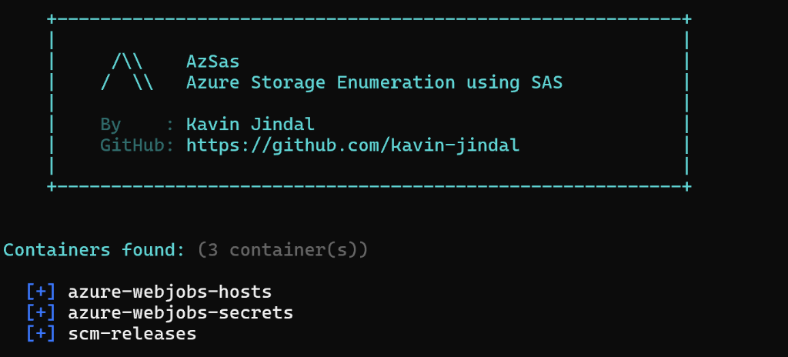
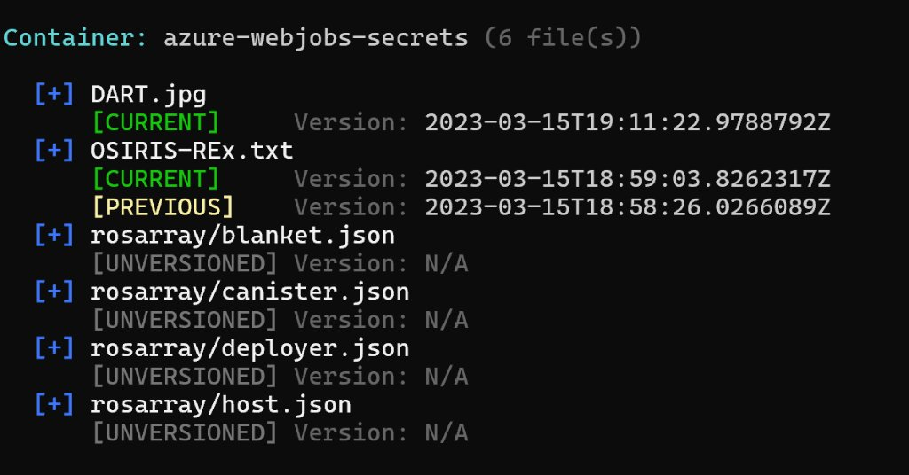

# AzSaS

Built around Shared Access Signature (SAS) tokens for red teaming scenarios where SAS tokens have been leaked. Supports listing containers, enumerating blobs and their versions, downloading accessible blobs, and inspecting token parameters.

## Installation

Install the required dependencies:

```bash
pip install -r requirements.txt
```

## Usage

All commands read the SAS token from a file passed via `--sas`.

### Inspect SAS Token

Display the parsed parameters of a SAS token:

```bash
python sass.py info --sas <sas_file>
```

### Enumerate Containers

List all accessible containers in a storage account:

```bash
python sass.py enumerate --account <storage_account> --sas <sas_file>
```

### Enumerate Blobs

List all blobs and their versions (`CURRENT`, `PREVIOUS`, `UNVERSIONED`) in a container:

```bash
python sass.py blob --account <storage_account> --sas <sas_file> -c <container>
```

### Download Blobs

Download all accessible blobs and previous versions from a container into `<output>/<container>/` (previous versions are saved under `<output>/<container>/versions/`):

```bash
python sass.py download --account <storage_account> --sas <sas_file> -c <container> -o <output_dir>
```

`-o` / `--output` defaults to `./`.

## Examples

### Enumerating Containers



### Enumerating Blobs & Versions


